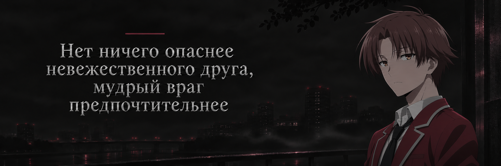
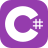

<b>RU</b> &nbsp; / &nbsp; <a href="README.en.md">EN</a>

<h1 align="center">mersibo</h1>

<strong>Fullstack-разработчик</strong> Магистр · Информационная безопасность и технологии искусственного интеллекта

&nbsp;&nbsp; 

<h2>01 &nbsp; Профиль</h2>

Fullstack-разработчик с магистерским образованием в области информационной безопасности. Мой стек охватывает веб-разработку, базы данных и инфраструктуру. Также работаю с Unity и интересуюсь AI и Data Science.

<h3>Образование</h3>

<strong>Национальный исследовательский университет «Высшая школа экономики»</strong> Магистр по направлению «Информационная безопасность и технологии искусственного интеллекта»

<h2>02 &nbsp; Технические навыки</h2>

<table>
<tr><td width="210"><strong>Языки программирования</strong></td><td>&nbsp; &nbsp; &nbsp; &nbsp; &nbsp; &nbsp; &nbsp; &nbsp; </td></tr>
<tr><td width="210"><strong>Frontend</strong></td><td>&nbsp; &nbsp; </td></tr>
<tr><td width="210"><strong>Backend</strong></td><td>&nbsp; </td></tr>
<tr><td width="210"><strong>Базы данных</strong></td><td>&nbsp; &nbsp; &nbsp; </td></tr>
<tr><td width="210"><strong>Инфраструктура</strong></td><td>&nbsp; &nbsp; </td></tr>
<tr><td width="210"><strong>Инструменты</strong></td><td>&nbsp; &nbsp; </td></tr>
<tr><td width="210"><strong>Разработка игр</strong></td><td></td></tr>
<tr><td width="210"><strong>AI / Data Science</strong></td><td>&nbsp; </td></tr>
</table>

<table width="100%">
<tr><td width="50%" valign="top">
<h3>03 &nbsp; Сейчас изучаю</h3>

</td><td width="50%" valign="top">
<h3>04 &nbsp; Интересы</h3>

&nbsp; &nbsp; 

</td></tr>
</table>

&nbsp;&nbsp; 

mersibo · Разработка и информационная безопасность

