# mersibo

**Русский** · [English](README.en.md)

Fullstack-разработчик.

Магистр ВШЭ по направлению «Информационная безопасность».

## Стек

**Языки**

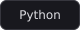
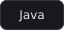

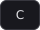
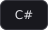
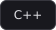
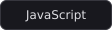
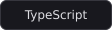
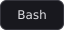

**Frontend**

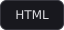
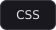
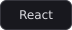

**Backend**

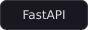
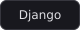

**Базы данных**

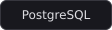
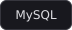
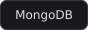
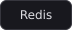

**Инфраструктура**

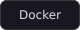
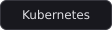
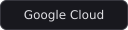

**Инструменты**

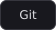
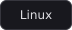
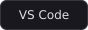

**Разработка игр**

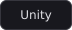

**Направления**

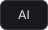
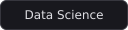

## Сейчас изучаю

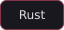

## Интересы

&nbsp;&nbsp;

&nbsp;&nbsp;

## Контакты

