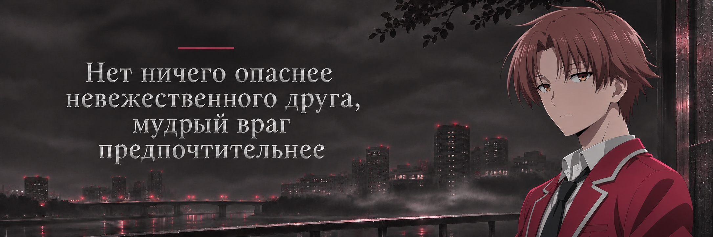
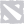
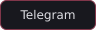
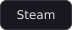

# mersibo

**Русский** · [English](README.en.md)

Fullstack-разработчик.

Магистр ВШЭ по направлению «Информационная безопасность».

## Стек

**Языки**

**Frontend**

**Backend**

**Базы данных**

**Инфраструктура**

**Инструменты**

**Разработка игр**

**Направления**

## Сейчас изучаю

## Интересы

&nbsp;&nbsp;

&nbsp;&nbsp;

## Контакты

